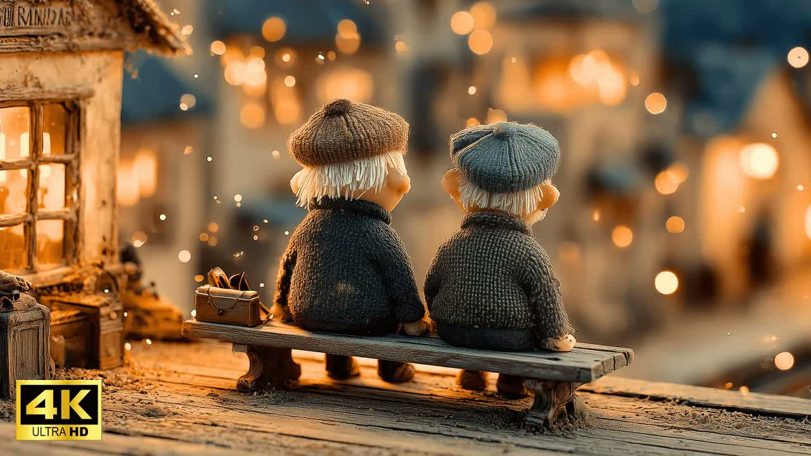
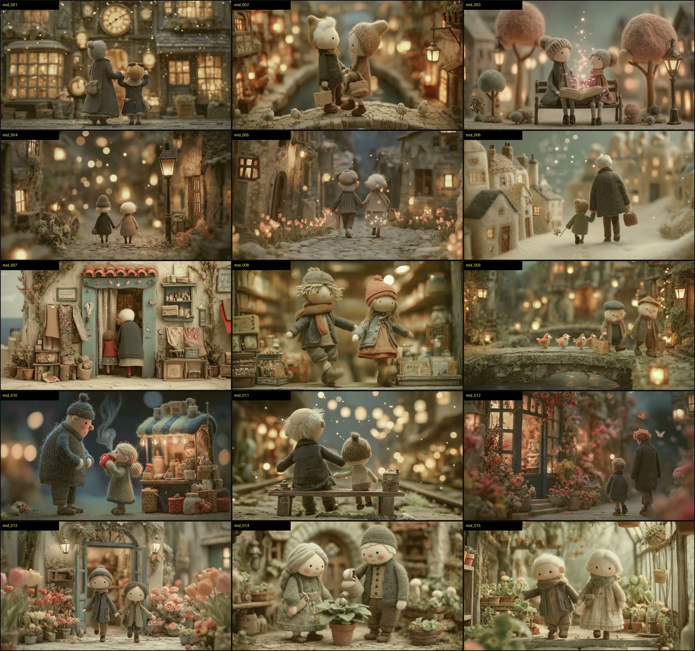
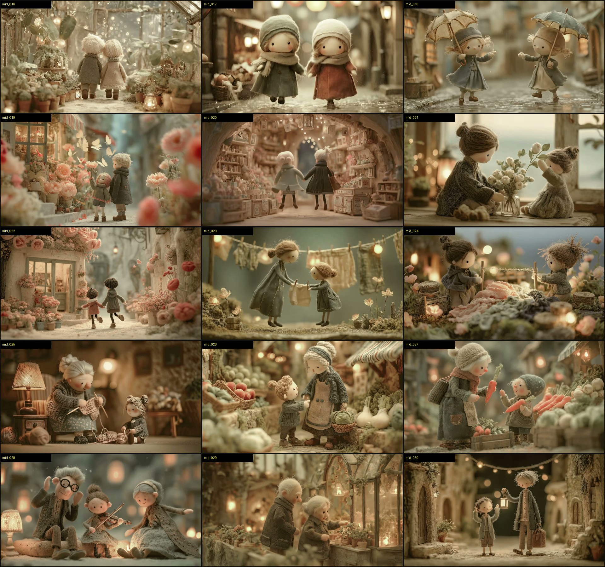
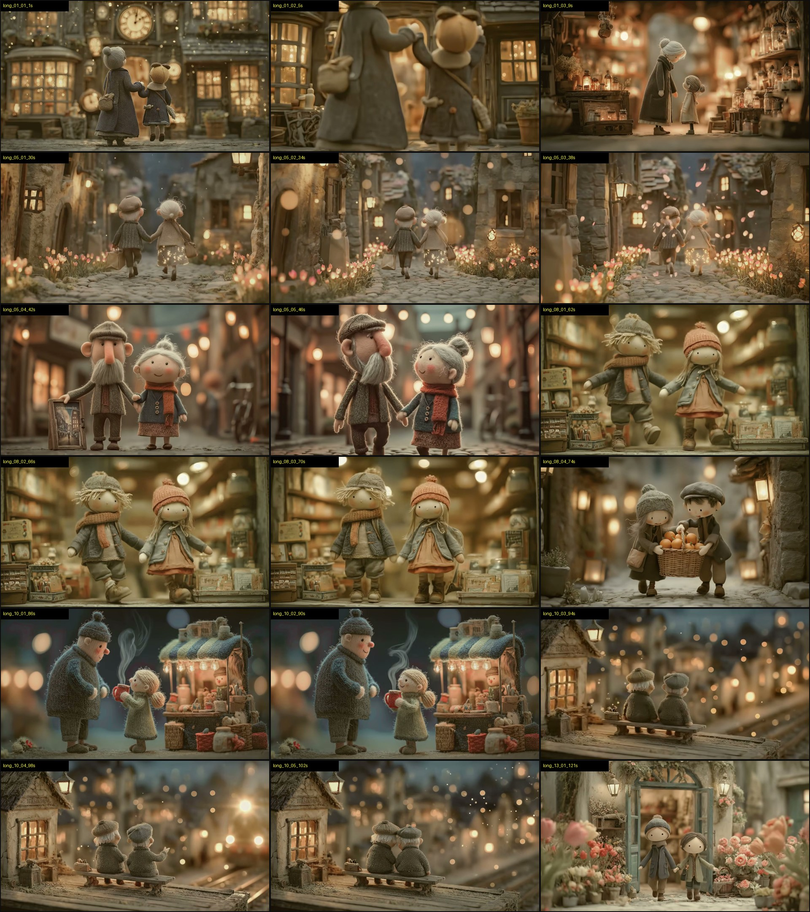
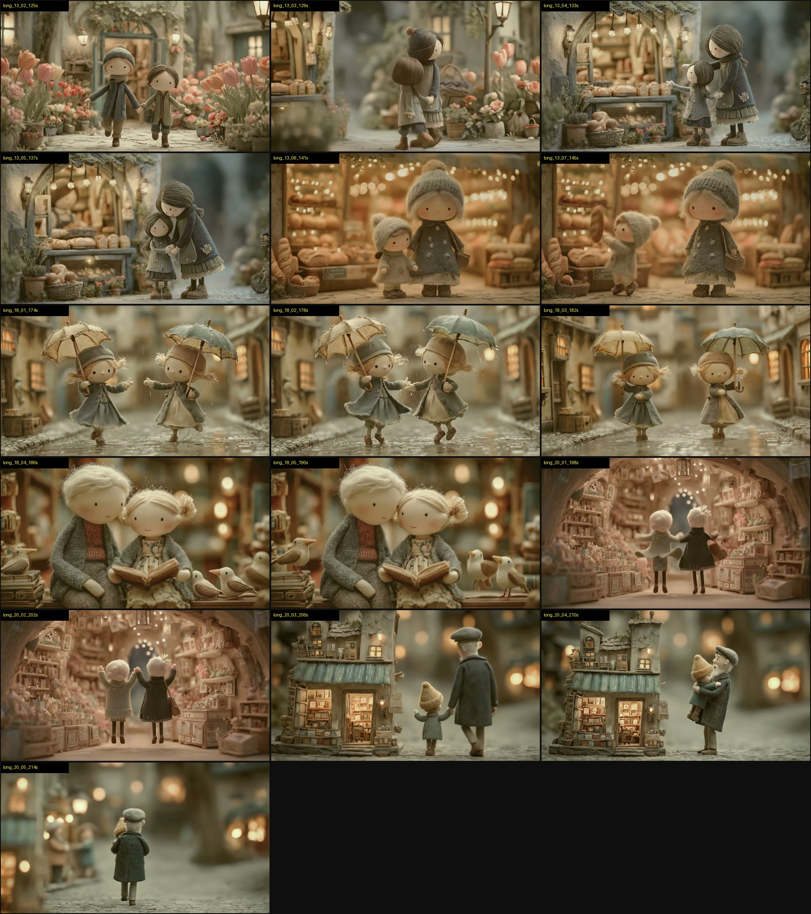

# Giải Phẫu Đối Thủ: AI Dreams Gallery NeuR. (`QpOyl_wxBiI`) & Thiết Kế Style Mới Từ Gốc

> [!IMPORTANT]
> **Nguyên tắc thực thi:** Báo cáo này được trích xuất **100% trực tiếp từ luồng video, âm thanh, dữ liệu kênh và khung hình thực tế** của video `QpOyl_wxBiI` (*A Town of Warmth and Kindness 1*), hoàn toàn độc lập, không dựa vào bất kỳ tài liệu sẵn có nào trong workspace.

---

## PHẦN 1: HỒ SƠ ĐỐI THỦ & TẠI SAO VIDEO NÀY THẮNG (DATA THỰC TẾ)

* **Video:** *A Town of Warmth and Kindness 1 | NeuR. Official Music Video 4K* (`QpOyl_wxBiI`)
* **Kênh:** **AI Dreams Gallery NeuR.** (`UCQkwwPU14uqBB7E9C45IkkQ`)
* **Hiệu suất:** **156,864 views** | **2,260 likes** (tỷ lệ Like/View ~1.44% — rất cao cho ngách nhạc AI) | **149 bình luận** | Thời lượng: **4:49 (289 giây)**.
* **Tech Stack tự khai báo & kiểm chứng:** Midjourney (Tạo ảnh gốc) + Kling AI / Veo 3.1 (Image-to-Video) + Suno AI (Nhạc).

### Cú "Pivot" Đổi Đời Của Kênh NeuR. (Bằng chứng từ dữ liệu 15 video gần nhất)
Khi quét lịch sử kênh của đối thủ, một quy luật sống còn lộ rõ:
* Các video làm kiểu "Surreal AI hỗn tạp" của kênh này đều **flop**:
  * *The penguins received a notice...*: **2,500 views**
  * *Can Mechanical Creatures Live in Harmony...*: **4,400 views**
  * *Sea Turtles Today's Walk*: **5,000 views**
  * *Birds Dancing Between Dream and Reality 2*: **5,300 views**
* Nhưng ngay khi kênh chạm vào **Visual Style "Búp bê nỉ len thủ công trong thị trấn cổ tích ấm áp" (Felt/Wool Miniature Figures)**, view nổ gấp **30–40 lần**:
  * *A Town of Warmth and Kindness 1* (`QpOyl_wxBiI`): **156,000 views**
  * *When Felt Figures Dream - A Gentle Ensemble* (`4eAZkQanrMc`): **196,000 views**
  * Kéo theo cả chuỗi sequel: Phần 2 (**40,000 views**), Phần 3 (**44,000 views**), *When Felt Figures Dream 2* (**42,000 views**).

> [!CAUTION]
> **Cảnh báo rủi ro thực tế từ chính đối thủ (`[HIGH RISK]`):** Ngay ở phần đầu Description, chủ kênh NeuR. cầu cứu fan vì **tài khoản đang bị YouTube hạn chế (account restrictions) và kháng cáo thất bại**. Nguyên nhân phổ biến nhất của các kênh AI Music Video dạng này là bị quét **Reused Content / Repetitive AI Content** khi nhân bản hàng loạt video cùng một công thức hình ảnh tĩnh + nhạc Suno mà thiếu biến thiên cấu trúc hoặc thiếu dấu ấn biên tập đủ sâu.

---

## PHẦN 2: GIẢI PHẪU THỊ GIÁC (VISUAL REVERSE-ENGINEERING)

````carousel

<!-- slide -->

<!-- slide -->

<!-- slide -->

<!-- slide -->

````

### 1. Chất liệu Vật lý (Tactile Materiality) — Vũ khí ăn tiền số 1
Đối thủ không vẽ 3D Pixar bóng mượt, cũng không vẽ 2D Anime. Họ đánh vào **Tactile Nostalgia (Hoài niệm xúc giác)** — nhìn vào ảnh là ngón tay người xem "cảm nhận" được độ nhám:
* **Da & Khuôn mặt:** Vải nỉ ép mịn (needle-felted wool / mattebisque felt), má ửng hồng phấn khô, hai mắt là **2 hạt cườm đen nhỏ xíu (tiny black bead eyes)** đặt xa nhau, không có miệng cầu kỳ hoặc chỉ là một nét khâu mỉm cười rất mảnh.
* **Tóc & Râu:** Sợi len thô, sợi chỉ cotton hoặc sợi đay (yarn strands / frayed twine) xù tự nhiên, bắt sáng ven (rim light) cực mạnh ở từng sợi tơ.
* **Quần áo:** Len đan tay mắt to (chunky cable-knit sweaters), vải bố, dạ sờn (tweed/burlap), thấy rõ từng mũi đan và lớp lông tơ (fuzzy wool halo).
* **Kiến trúc & Đạo cụ:** Tường vữa trát tay bong tróc kiểu mô hình diorama (miniature plaster & papier-mâché), gỗ mục xước, đá cuội rêu phong, hoa lá làm bằng vải/len hoặc giấy nhún.

### 2. Quang học & Ánh sáng (Optics & Lighting Formula)
* **Ống kính Macro Tilt-Shift:** Giả lập ống kính `85mm` hoặc `100mm Macro` mở khẩu cực lớn (`f/1.4 - f/1.8`). Mặt phẳng nét (focal plane) rất mỏng chỉ cắt ngang đúng 2 nhân vật; toàn bộ tiền cảnh sát đất và hậu cảnh cách 2 mét đều nhòe thành các vòng tròn ánh sáng (**creamy circular bokeh**).
* **Hệ thống 2 màu tương phản (Dual-Tone Palette):**
  * **Ambient / Shadow (Môi trường):** Xám tro, xanh rêu bẩn, xanh slate trầm, nâu đất nhạt (Desaturated Sage, Slate Grey, Dusty Taupe). Độ bão hòa màu nền bị kéo thấp xuống để không gây mỏi mắt.
  * **Highlight / Practical Lights (Điểm sáng):** Vàng hổ phách, cam đèn dây tóc, hồng san hô nhạt (Warm Amber `#FFB347`, Tungsten Gold). Mọi khung hình đều có đèn lồng, cửa sổ phát sáng, dây đèn fairy lights hoặc bụi phép thuật (floating golden dust motes).

### 3. Bố cục & Góc máy (Framing & Staging)
* **Quy tắc "Cặp đôi Đa thế hệ" (Dyadic Pairing):** 95% số cảnh luôn có **đúng 2 nhân vật** (Ông/Bà + Cháu nhỏ, hoặc 2 cụ già, hoặc 2 đứa trẻ) đứng cạnh nhau ở trung tâm khung hình. Sự chênh lệch chiều cao (1 lớn - 1 nhỏ) tạo ra cảm xúc che chở, tử tế ngay lập tức mà không cần cốt truyện.
* **Góc máy ngang tầm mắt búp bê (Miniature Eye-Level):** Camera đặt sát mặt đất ngang ngực nhân vật, trục máy vuông góc với tường/cửa hàng phía sau (Flat/Symmetric Planimetric staging kiểu Wes Anderson kết hợp Stop-motion Laika).

### 4. Nhịp điệu Dựng phim & Chuyển động (Pacing & Motion Architecture)
Quét toàn bộ 289 giây bằng thuật toán sai biệt điểm ảnh (Pixel MAD), video có **45 cú cắt cảnh (shots)**:
* **Độ dài mỗi shot:** Dao động từ **4.5s đến 10.0s** (trung bình **~6.3 giây/shot**). Đây là độ dài nguyên bản của 1 clip xuất ra từ **Kling AI (5s / 10s)** hoặc **Veo 3 (6s - 8s)**.
* **Tại sao thuật toán phát hiện cảnh thông thường chỉ thấy 29 cuts?** Vì ở các đoạn như `0:30–0:50`, `1:01–1:18`, `1:26–1:43`, `2:00–2:28`, đối thủ ghép 2–3 cảnh liên tiếp có **cùng một bố cục sáng tối và bảng màu y hệt nhau** (chỉ đổi nhân vật hoặc góc cận/toàn), khiến mắt người xem lướt qua cú cắt cực kỳ êm.
* **Loại chuyển động:** Chuyển động cực chậm (Slow-motion ~50–60% speed): nắm tay đi bộ, nghiêng đầu vào nhau, đưa củ cà rốt, tưới cây, cầm ô nhún nhảy dưới mưa, tàu hỏa mờ ảo chạy ngang hậu cảnh.

---

## PHẦN 3: BẮT LỖI ĐỐI THỦ — NHỮNG ĐIỂM YẾU CHẾT NGƯỜI ĐỂ MÌNH VƯỢT QUA

Dưới góc nhìn khắt khe (Adversarial Verification), video của NeuR. đẹp nhưng lộ **4 tử huyệt kỹ thuật** mà nếu bạn khắc phục được hoặc rẽ nhánh style, kênh của bạn sẽ ăn đứt:

1. **Hội chứng "Trôi lơ lửng & Dị dạng giải phẫu" (`[HIGH RISK]`):**
   * Nhìn kỹ `mid_017`, `mid_020`, `long_13_02`, `long_20_02`: Nhân vật đi bộ nhưng bàn chân **không chạm đất**, lơ lửng như ma.
   * Ở `long_05_04` (giây 42): Đột ngột xuất hiện một ông già có **cái mũi to tướng kiểu hoạt hình 3D khác hẳn** búp bê mắt hạt cườm ở các cảnh khác -> **Gãy tính nhất quán thiết kế nhân vật (Style Drift)**.
   * Ở `mid_028`: Ông già đeo kính có bàn tay 4 ngón to bè kiểu đất sét, trong khi cô bé chơi violin bên cạnh lại là mặt búp bê nhựa phẳng.
2. **Lạm dụng hạt Bokeh bay lơ lửng (Bokeh Spam):**
   * Hầu như cảnh nào cũng nhét đốm sáng bay (floating particles) dù là ban ngày hay trong nhà kính trồng cây (`mid_016`), làm hình ảnh bị cảm giác "rác AI" (AI slop) nếu xem quá 2 phút.
3. **Không có Đường cong Thị giác theo Nhạc (Flat Visual Arc):**
   * Phân tích RMS âm thanh cho thấy bài nhạc có đoạn lắng xuống ở `210s–220s` (`-19.7 dBFS`) rồi bùng lên cao trào (Climax) ở `230s–250s` (`-13.2 dBFS`). Thế nhưng ở phút thứ 4 (`240s`), hình ảnh của đối thủ lại chỉ là... hai bà cháu đứng mua cải bắp và cà rốt ngoài chợ (`mid_026`, `mid_027`)! Hình ảnh hoàn toàn **trật khớp với cao trào cảm xúc của âm nhạc**.

---

## PHẦN 4: THIẾT KẾ STYLE MỚI ĐỘC LẬP CHO BẠN (TỪ GỐC VẬT LÝ — KHÔNG DỰA VÀO TÀI LIỆU NÀO)

Bạn muốn tạo ra **1 Style mới** cho các ảnh của 1 video tương tự: giữ nguyên được "hiệu ứng tâm lý gây nghiện" của đối thủ (Xúc giác thủ công + Hoài niệm ấm áp + Thế giới thu nhỏ + Cặp đôi gắn kết), nhưng **không copy nguyên xi "búp bê len đan" của NeuR.** để tránh đụng hàng và tránh lỗi quét Reused/Repetitive Content.

Nguyên lý cốt lõi để tạo ra một Style ăn khách trong ngách này là công thức **4 Trụ Cột Vật Lý**:
$$\text{Visual Style} = \text{Vật liệu Nhân vật (Tactile Toy)} + \text{Chất liệu Kiến trúc (Diorama Craft)} + \text{Nguồn sáng Nội tại (Internal Glow)} + \text{Ống kính Thu nhỏ (Macro Optics)}$$

Dưới đây là **3 Hệ Style Mới Hoàn Toàn (Original Visual Styles)** được thiết kế từ gốc để bạn chọn (hoặc lấy luôn Style 1 làm chủ lực):

---

### STYLE ĐỀ XUẤT SỐ 1 (KHUYẾN NGHỊ MẠNH NHẤT): **"Artisanal Layered Paper-Cut & Pressed-Botanical Shadowbox"** *(Thế giới Rối Giấy Dó Cắt Lớp & Hoa Khô Ép Đèn Lồng)*

Thay vì dùng len đan (vốn đã bị NeuR. và hàng chục kênh clone cày nát), bạn chuyển sang chất liệu **Giấy mỹ thuật có gân xơ (Textured Mulberry/Washi Paper) kết hợp Lá/Hoa khô ép (Pressed Botanicals) và Gỗ Balsa mỏng**.

* **Tại sao Style này thắng tuyệt đối?**
  1. **Xúc giác cực mạnh:** Người xem thấy rõ từng thớ sợi giấy xù nhẹ ở mép cắt, gân lá khô trong suốt khi có đèn chiếu xuyên qua (Subsurface Scattering / Translucency).
  2. **Không bao giờ bị lỗi chân lơ lửng hay biến dạng mặt AI:** Vì nhân vật mang hình thái búp bê giấy xếp lớp 3D (3D layered paper-art doll / origami-sculpted figurine), chuyển động hơi khựng nhẹ kiểu Stop-Motion tự nhiên trở thành "chất nghệ thuật" chứ không bị coi là lỗi AI!
  3. **Ánh sáng xuyên thấu (Backlit Lantern Glow):** Len chỉ phản xạ ánh sáng ở viền, còn **giấy dó và cánh hoa khô cho phép ánh sáng vàng ấm xuyên qua từ phía sau**, tạo độ sâu lung linh gấp đôi khi lên màn hình 4K OLED.

#### Bộ Quy Chuẩn Thị Giác (Visual Bible) của Style 1:
1. **Nhân vật (Character Anatomy):**
   * Đầu tròn làm từ giấy bồi nhám mờ (matte textured papier-mâché), má phớt màu nước hồng đào, mắt chấm mực tàu đen nhỏ, tóc xếp từ các dải giấy gân dài uốn cong mềm mại.
   * Trang phục: Áo khoác và váy làm từ các lớp giấy washi dày có họa tiết dập nổi (embossed paper), khăn quàng bằng vải xô mỏng (gauze/linen ribbon), viền áo có đường chỉ khâu tay thật.
2. **Bối cảnh (Environment & Props):**
   * Thị trấn diorama dựng từ gỗ balsa mỏng, bìa carton mỹ thuật cắt lớp (layered shadowbox architecture), mái ngói bằng vỏ cây khô và cánh hoa ép, cây cối làm từ hoa baby khô và lá phong ép mỏng phát sáng.
3. **Bảng màu & Ánh sáng (Color & Lighting):**
   * **Màu nền:** Xanh chàm tối (Muted Indigo `#1E2631`), Xám trà (Warm Parchment Grey `#8C857B`), Xanh rêu khô (Dried Moss `#4A5D4E`).
   * **Ánh sáng xuyên lớp (Transmissive Warm Glow):** Đèn vàng cam (`#FF9E44`) đặt ẩn **bên trong** các ngôi nhà giấy và đèn lồng, chiếu xuyên qua các lớp cửa sổ giấy can (vellum paper) tạo quầng sáng mềm.
4. **Ống kính (Camera & Depth):**
   * `90mm Tilt-Shift Macro Lens, f/2.0`, độ sâu trường ảnh mỏng với nhiều lớp tiền cảnh (foreground silhouette layers) và hậu cảnh xếp lớp như một hộp kịch (layered theater diorama).

#### Công thức Prompt Mẫu (Master Prompt Template cho Midjourney v6.1 / Flux / Nano Banana):
```text
[Subject & Action: e.g., An elderly grandfather figure and a tiny granddaughter figure holding hands, walking slowly past a miniature bakery window], crafted entirely as a 3D tactile stop-motion diorama made of textured handmade mulberry washi paper, pressed autumn leaves, and thin balsa wood. The characters are delicate papier-mâché and layered textured paper dolls with tiny black ink-dot eyes, soft watercolor rosy cheeks, and flowing layered paper-strip hair, wearing embossed kraft-paper coats with real stitched thread details. Warm golden tungsten light glows from inside translucent vellum paper windows, creating subsurface scattering through dried botanical petals and paper edges. Shallow depth of field, 90mm macro tilt-shift lens, f/1.8, cinematic layered shadowbox composition, muted indigo and warm parchment color palette, hyper-detailed paper fibers and tactile craft textures, no CGI plastic sheen --ar 16:9 --stylize 350
```

---

### STYLE ĐỀ XUẤT SỐ 2: **"Carved Linden-Wood & Matte Bisque Porcelain Automatons"** *(Búp Bê Gỗ Đoạn Khắc Tay & Sứ Mờ Trong Thị Trấn Đồng Hồ Cổ)*

Nếu bạn muốn giữ khối 3D tròn trịa giống đối thủ hơn nhưng sang trọng và cổ điển kiểu châu Âu:
* **Chất liệu nhân vật:** Khuôn mặt bằng **sứ mờ không tráng men (matte bisque porcelain)** hoặc **gỗ đoạn (carved linden wood)** thấy rõ vân gỗ mịn và vết đục chạm tay; quần áo vẫn kết hợp vải dạ thô (boiled wool/linen) để giữ độ mềm khi bước đi.
* **Bối cảnh:** Thị trấn đá cuội rêu phong, các cửa tiệm có chi tiết đồng thau cũ (aged brass), kính màu mờ (frosted stained glass), gỗ sồi trầm.
* **Ánh sáng:** Ánh sáng dầu hỏa / nến ấm (Candlelight Gold `#F4A261`) đối lập với sương mù xanh lam chiều tà (Twilight Prussian Blue `#1D3557`).
* **Prompt Core Keywords:**
  ```text
  hand-carved linden wood and matte bisque porcelain miniature stop-motion figures, visible fine woodgrain and artisan chisel textures, wearing boiled wool felt coats, tiny obsidian bead eyes, set in a mossy cobblestone miniature diorama town with aged brass lanterns and frosted glass windows, warm candlelight glow against misty twilight blue shadows, 85mm macro lens f/1.4, tactile handcrafted stop-motion aesthetic --ar 16:9
  ```

---

### STYLE ĐỀ XUẤT SỐ 3: **"Oil-Pastel Impasto & Stitched Canvas Storybook"** *(Tranh Sơn Dầu Đắp Nổi Kết Hợp Vải Thêu Nổi 3D)*

* **Chất liệu:** Lai giữa **vải bố thêu nổi (stitched linen canvas)** và **vệt màu sơn dầu/sáp dầu đắp dày thành khối 3D (thick tactile impasto oil-pastel strokes)**.
* **Hiệu ứng thị giác:** Mọi đám mây, tán cây, mái nhà và gò má nhân vật đều có độ dày vật lý của vệt cọ sơn đắp nổi trên nền vải bố, bắt ánh sáng xiên tạo bóng đổ thật.
* **Prompt Core Keywords:**
  ```text
  3D tactile diorama crafted from thick sculpted impasto oil-pastel strokes and hand-stitched raw linen canvas, miniature storybook characters with textured clay-impasto faces and embroidered yarn coats, standing in a glowing European alley where every cobblestone and flower petal is a thick physical dab of oil paint catching warm golden rim light, macro tilt-shift photography, f/1.8 --ar 16:9
  ```

---

## PHẦN 5: KỊCH BẢN PHÂN CẢNH (STORYBOARD FLOW) NÂNG CẤP ĐỂ ĐÁNH BẠI ĐỐI THỦ

Thay vì cắt ghép ngẫu nhiên 45 cảnh đi bộ và đi chợ như NeuR., khi bạn áp dụng Style mới cho 1 video (~4 phút, khoảng **36–40 shots**, mỗi shot **5–8 giây**), hãy khóa chặt **Cấu trúc 4 Hồi Khớp Nhạc (Audio-Visual Sync Arc)**:

| Hồi (Act) | Thời lượng | Nhịp nhạc (Dynamics) | Thiết kế Bố cục & Hành động (Visual Staging) | Ánh sáng & Màu sắc |
| :--- | :--- | :--- | :--- | :--- |
| **Hồi 1: Khởi thức (The Quiet Dawn)** | `0:00 – 0:50` (8 shots) | Nhẹ, thưa, tiếng đàn mộc (`~ -20 dBFS`) | Mở đầu bằng cảnh tĩnh: Cửa tiệm vừa bật đèn sáng, ông/bà mở cửa sổ, hai nhân vật bước ra phố vắng. Góc máy trung cảnh (Medium Wide). | Xanh sương sớm chủ đạo (70% Cool / 30% Warm). Ít hạt bay. |
| **Hồi 2: Kết nối & Sẻ chia (The Warm Town)** | `0:50 – 2:10` (13 shots) | Nhịp trống/bass nhẹ vào, giai điệu ấm (`~ -15 dBFS`) | Chuỗi hành động tử tế nhỏ: trao chiếc bánh nướng bốc khói, che chung chiếc ô dưới mưa, đọc sách trên ghế gỗ, sửa lại khăn quàng. Đan xen 1 cảnh Toàn -> 2 cảnh Cận. | Cân bằng 50% Cool / 50% Warm. Ánh đèn cửa tiệm rực rỡ. |
| **Hồi 3: Khoảnh khắc Lắng đọng (The Bridge)** | `2:10 – 2:50` (6 shots) | Nhạc chùng xuống, chỉ còn piano/violin đơn (`~ -19 dBFS`) | Nhân vật ngồi yên: ngắm đoàn tàu chạy qua trong sương, hoặc ngồi bên hiên nhà nhìn lá/hoa rơi chậm. Camera dolly-in cực chậm. | Chuyển sang tông Chiều tà / Hoàng hôn tím trầm. |
| **Hồi 4: Cao trào & Dư âm (Climax & Outro)** | `2:50 – 4:00+` (10 shots) | Dàn dây/Hợp xướng bùng nổ rồi tan dần (`-13 dBFS -> -25 dBFS`) | **Khắc phục lỗi của đối thủ:** Tuyệt đối không cho đi mua rau ở đoạn này! Phải là cảnh **Lễ hội đèn lồng thị trấn**, cả con phố bừng sáng, hoa/ánh sáng bay lên bầu trời đêm, kết thúc bằng cảnh 2 nhân vật cầm đèn lồng đi xa dần vào ngõ ấm. | 80% Warm Golden Glow bao phủ khung hình, khép lại bằng fade-out đèn lồng. |
