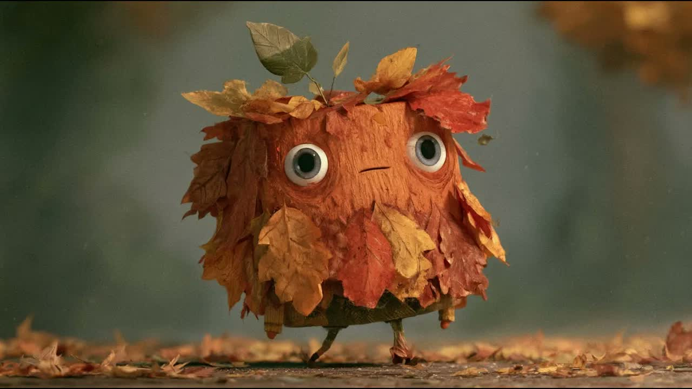
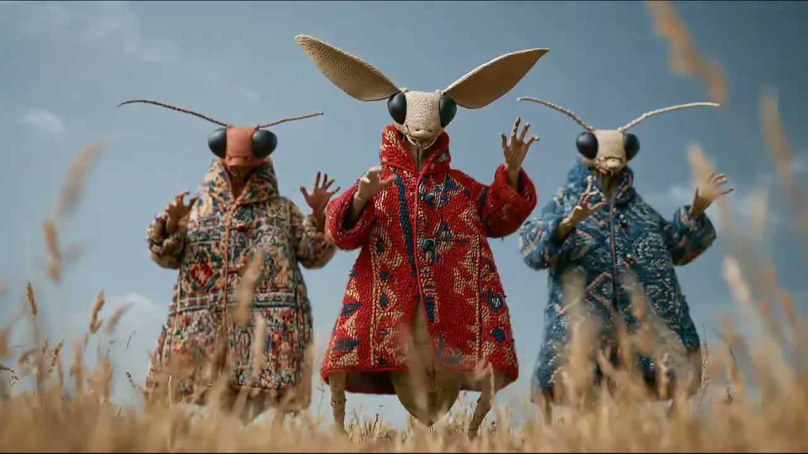
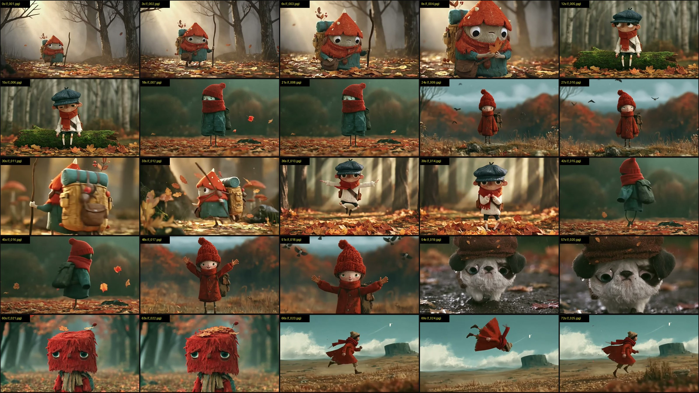
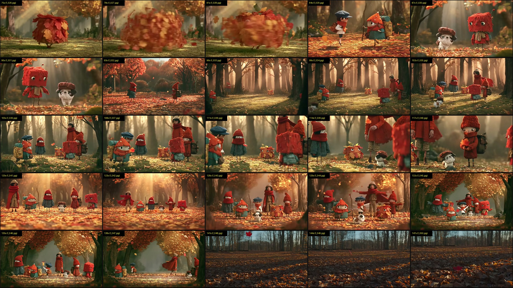

# Giải Phẫu Đối Thủ: Harriet Moser (`aw6wncA_biU`) & Công Thức "Lười" Cho Thế Giới Sinh Vật Nhỏ Kỳ Lạ

> [!NOTE]
> Tài liệu này mổ xẻ trực tiếp video `aw6wncA_biU` (*🍂 LEAVES, LEAVES 🍂*) cùng toàn bộ 26 video trên kênh **Harriet Moser** (`UCSjX8n9tNBGpRuHHOU-TfaA`), đồng thời đối chiếu với tư duy **"Không muốn nghiên cứu hay thay đổi quá nhiều"** của bạn để chỉ ra đâu là mỏ vàng thật và đâu là cái bẫy mất thời gian.

---

## 1. SỰ THẬT PHŨ PHÀNG VỀ KÊNH HARRIET MOSER (REALITY CHECK)

Trước khi bắt chước nguyên xi video `aw6wncA_biU`, bạn cần nhìn vào bảng dữ liệu toàn kênh của đối thủ này để không đi vào vết xe đổ của họ:

| Nhóm Video trên kênh Harriet Moser | Ví dụ tiêu biểu | Lượng View thực tế | Đặc điểm sản xuất |
| :--- | :--- | :--- | :--- |
| **Nhóm Nổ View (120K – 293K views)** | *Stefanie* (`293,000`), *Snug as a bug in a rug* (`123,000`), *Luma Ray 3.2* (`73,000`) | **73,000 – 293,000 views** | **Cực kỳ LƯỜI & ĐƠN GIẢN:** Chỉ 1 đến 3 nhân vật/sinh vật kỳ lạ đứng thẳng giữa khung hình, nền cực thoáng (cánh đồng cỏ hoặc phông trơn), nhún nhảy/lắc lư theo nhạc. |
| **Nhóm Trung bình (12K – 44K views)** | *Thank God It's Thursday* (`44,000`), *April girl* (`26,000`), *Gnu with a flu* (`14,000`) | **12,000 – 44,000 views** | Sinh vật đơn lẻ hoặc cặp đôi kỳ quặc trong 1 bối cảnh cố định. |
| **Nhóm Đi Xuống (400 – 4,500 views)** | *The end of the world* (`692`), *Shadows* (`441`), *A strange day* (`3,000`), *🍂 LEAVES, LEAVES 🍂* (`Vừa đăng`) | **440 – 4,500 views** | Cố gắng kể chuyện buồn lê thê, cắt cảnh phức tạp, gom nhiều nhân vật vào 1 khung hình ở nửa cuối. |

````carousel

<!-- slide -->

<!-- slide -->

<!-- slide -->

````

---

## 2. TẠI SAO HƯỚNG "THẾ GIỚI SINH VẬT NHỎ KỲ LẠ" LÀ LỰA CHỌN TỐI ƯU CHO NGƯỜI LƯỜI?

Bạn nói rất thật: *"Thực tế t không muốn phải nghiên cứu, thay đổi quá nhiều"*.
Nếu làm về **con người** hay **thị trấn kiến trúc phức tạp** (như kênh NeuR. ở bài trước), bạn sẽ mệt ở chỗ: phải giữ đồng nhất khuôn mặt ông bà cháu, phải dựng phố xá cửa tiệm, bàn chân bước đi lệch một chút là lộ lỗi AI.

Còn khi chuyển sang **"Thế giới nơi mọi sinh vật nhỏ kỳ lạ đều sống"** (như các nhân vật trong `aw6wncA_biU`), bạn được hưởng **4 Đặc Quyền Của Kẻ Lười (Lazy Producer Advantages)**:

1. **Không tồn tại khái niệm "Lỗi Giải Phẫu AI" (Zero Anatomy Failure):**
   * Nhìn vào `grid_1.jpg`: Nhân vật là một khối vuông lông đỏ có 2 mắt to (`60s`), một cục gỗ phủ lá sồi khô có 2 que củi làm chân (`thumbnail`), một cậu bé đội mũ nấm đỏ đeo balo (`6s`), một chú chó pug đội mũ beret bằng vỏ cây (`54s`), một bé gái quấn khăn len kín hết miệng chỉ hở mắt (`18s`).
   * **Bí quyết lười:** Hầu hết nhân vật đều **giấu miệng** (quấn khăn kín cổ, hoặc miệng chỉ là 1 vạch ngang cố định) và **chân là 2 que tăm/cành cây mảnh**. Bạn không bao giờ phải lo Lip-sync (nhép môi) hay lo bàn tay 6 ngón!
2. **Không cần Đồng nhất Nhân vật (Zero Character Consistency Needed):**
   * Vì định vị của bạn là *"Thế giới nơi ĐỦ LOẠI sinh vật kỳ lạ cùng sống"*, nên mỗi khi AI đẻ ra một con quái vật/sinh vật hơi khác đi một chút, người xem lại tưởng là... **một loài cư dân mới trong khu rừng đó**! Bạn không cần dùng Character Reference phức tạp hay giữ mặt giống nhau 100% giữa 30 cảnh.
3. **Bối cảnh Rừng/Thiên nhiên Cực dễ Prompt (Zero Architecture Hassle):**
   * Không cần vẽ tiệm bánh, đồng hồ, biển hiệu chữ nghĩa (vốn rất hay bị chữ AI vô nghĩa). Chỉ cần: **Thảm lá rụng + Thân cây mờ sương phía sau + Nắng xiên (God rays)**. Một câu prompt bối cảnh dùng lại cho cả 40 cảnh!
4. **Chuyển động Cực kỳ Ngáo & Đơn giản (Absurdist Micro-Motion):**
   * Nhìn các cảnh trong `aw6wncA_biU`:
     * Đứng yên chớp mắt to tròn (`0s - 12s`).
     * Nhảy tưng tưng tại chỗ hoặc xoay vòng tròn làm lá bay (`36s`, `78s`).
     * Chạy ngang rồi bị gió thổi bay lộn ngược lên trời một cách vô lý nhưng hài hước (`69s - f_024.jpg`).

---

## 3. CẢNH BÁO TỬ HUYỆT TRONG VIDEO `aw6wncA_biU` (ĐỂ BẠN KHÔNG MẮC PHẢI)

> [!WARNING]
> **Sai lầm lớn nhất của Harriet Moser ở nửa cuối video (`96s – 138s`):**
> Từ giây `0s` đến `75s`, mỗi cảnh chỉ có **1 sinh vật đứng giữa khung hình** (nhìn cực nét, chất liệu lá cây/lông xù nổi bần bật).
> Nhưng từ giây `96s` đến `138s` (`grid_2.jpg`), tác giả cố nhồi **6–7 nhân vật đứng tụ tập cùng lúc** ở cảnh toàn (Wide shot). Kết quả: Nhân vật bé tí, mặt mũi biến dạng nhòe nhoẹt, chân tay dính vào nhau, đứng đơ như tượng sáp suốt 40 giây!
> **Quy tắc bất di bất dịch cho bạn:** Chỉ làm **1 sinh vật/cảnh (Medium Close-up)** hoặc tối đa **2 sinh vật đứng cạnh nhau**. Tuyệt đối không làm đại cảnh 6–7 con đứng chung!

---

## 4. CÔNG THỨC "LƯỜI" ĐÓNG GÓI SẴN (ONE-TEMPLATE SYSTEM — CỨ THẾ XÀI MÃI)

Để bạn **không phải nghiên cứu hay thay đổi nhiều**, đây là **Bộ Khung Cố Định (Evergreen System)** dùng chung cho hàng chục video. Mỗi khi làm video mới, bạn chỉ cần thay **1 từ khóa Thời tiết/Mùa** và **Danh sách 10 món đồ tự nhiên ghép thành sinh vật**.

### A. Khung Thiết Kế Sinh Vật Tự Động (The "Foraged Creature" Generator)
Mọi sinh vật trong thế giới của bạn đều được lắp ghép từ công thức 4 mảnh (không bao giờ lộ mặt người thật để tránh lỗi AI):
1. **Thân (Body Shape):** Khối hộp vuông xù (boxy furry cube), củ khoai tròn (plump round bulb), hoặc áo choàng len rộng thùng thình che kín người (oversized felted cloak).
2. **Đầu/Mũ (Head/Cap):** Mũ nấm đốm (spotted toadstool cap), tổ chim khô (woven twig nest), đám lá phong xếp lớp (layered autumn oak leaves), quả thông (pinecone helmet), hoặc mũ beret bằng rêu (mossy beret).
3. **Mắt & Mặt (Eyes & Face — Điểm ăn tiền nhất):** Đôi mắt thủy tinh tròn xoe hơi lồi và ướt (`large glossy expressive glass-bead eyes, slightly melancholic and curious`), **không có miệng** (hoặc khăn len quấn kín nửa dưới mặt).
4. **Chân & Phụ kiện (Limbs & Props):** Hai cái chân mảnh khảnh như cành cây khô (`thin twig-like stick legs`), đeo balo vải bố to hơn người (`oversized canvas backpack`) hoặc cầm một chiếc lá/đèn lồng.

### B. Master Image Prompt (Copy-Paste — Chỉ đổi phần trong ngoặc vuông `[...]`)

Bạn dùng **duy nhất 1 khung prompt này** cho toàn bộ video, chỉ thay dòng mô tả sinh vật ở đầu:

```text
A medium close-up eye-level shot of [MÔ TẢ SINH VẬT], standing in a misty enchanted woodland clearing covered in fallen leaves. Crafted in a tactile dark-fairytale stop-motion aesthetic (inspired by Laika Studios and Wes Anderson's Fantastic Mr. Fox), featuring hyper-detailed natural textures: real dried leaf veins, coarse felted wool, rough tree bark, damp moss, and frayed yarn. The creature has large expressive glossy round eyes and thin twig-like legs, centered composition. Soft volumetric morning god-rays filtering through tall blurry forest trees in the background, shallow depth of field, 85mm macro lens, f/1.8, earthy autumn palette of burnt orange, moss green, and misty slate grey, cinematic natural lighting, no plastic CGI look --ar 16:9
```

#### 10 Biến thể `[MÔ TẢ SINH VẬT]` sẵn sàng bỏ vào ngoặc vuông cho Video 1:
1. `a small cube-shaped forest creature covered entirely in layered red and gold autumn oak leaves, with two big round watery eyes peeking out`
2. `a tiny chubby woodland wanderer wearing a pointed red-and-white spotted mushroom cap as a helmet, a thick knitted rust-colored scarf hiding its mouth, and a huge canvas backpack`
3. `a melancholic miniature pug-like forest spirit wearing an oversized cap made of rough tree bark and acorns, with dewy whiskers`
4. `a shy little moss-covered creature shaped like a pinecone, wearing a miniature dark-green duffle coat and holding a single glowing yellow leaf`
5. `a quirky fluffy square-headed red yarn monster with tiny twig antlers sprouting a single green leaf on top`
6. `a tiny humanoid woodland figure wearing a blue newsboy cap and a giant knitted red scarf wrapped up to its big round doll eyes, sitting on a mossy fallen log`
7. `an adorable round chestnut-shell creature with spindly stick legs, wearing a patchwork tweed cape and carrying a tiny twig walking stick`
8. `a fuzzy dandelion-seed spirit wearing a crumpled felt raincoat, looking up at falling leaves with wide curious eyes`
9. `two tiny forest creatures standing side by side: one shaped like a mossy rock with big eyes, the other wearing a giant knitted beanie covering its ears`
10. `a little autumn sprite made of bound twigs and dried heather flowers, wearing miniature leather boots and a fluttering red scarf`

### C. Bộ 5 Motion Prompts Cố Định (Quay vòng cho mọi cảnh trong Kling / Veo / Luma)

Không cần nghĩ chuyển động phức tạp. Cứ 1 ảnh bạn áp 1 trong 5 câu lệnh chuyển động siêu ngắn này:
1. **Đứng ngơ ngác + Gió thổi (An toàn 100%):**
   `Static camera. The tiny creature stands still in the center, blinking its big round eyes slowly while autumn leaves blow past in the breeze and its scarf flutters gently. Tactile stop-motion feel.`
2. **Bước đi lạch bạch về phía trước (Tạo nhịp điệu):**
   `Slow tracking shot backward. The little creature waddles forward on its thin twig legs through the crunchy fallen leaves, backpack bouncing slightly with each step.`
3. **Nhảy tưng tưng / Xoay vòng (Cho đoạn điệp khúc Chorus):**
   `Static eye-level shot. The creature jumps up and down joyfully on the spot, kicking up a small swirl of autumn leaves around its feet.`
4. **Hành động siêu thực hài hước (Giống cảnh 69s và 78s của đối thủ):**
   `The creature spins rapidly like a tiny tornado of leaves, or gets gently lifted off the ground by a sudden gust of wind, floating comically across the frame.`
5. **Nghiêng đầu nhìn lá rơi (Cho đoạn nhạc dạo/Intro/Outro):**
   `Slow push-in camera. A single golden leaf drifts down from above; the creature tilts its head sideways to watch the leaf land on its nose.`

---

## 5. KẾT LUẬN CHIẾN LƯỢC CHO BẠN

Nếu đi theo hướng **"Thế giới sinh vật nhỏ kỳ lạ"** này:
* **Lấy phần xác (Visual) của video `aw6wncA_biU`:** Rừng sương mù + Sinh vật ghép từ lá/nấm/len/vỏ cây + Mắt tròn to + Không lộ miệng.
* **Lấy phần hồn (Pacing) của các video 100K–300K views trên cùng kênh đó (*Snug as a bug in a rug*, *Stefanie*):** Giữ khung hình **1 đến 2 sinh vật rõ nét ở trung tâm**, nhịp nhạc hơi dí dỏm/bắt tai (Indie Folk / Quirky Acoustic / Dreamy Pop) thay vì nhạc quá bi lụy, và **tuyệt đối bỏ đoạn nhồi 7 nhân vật đứng đơ ở cuối video**.
